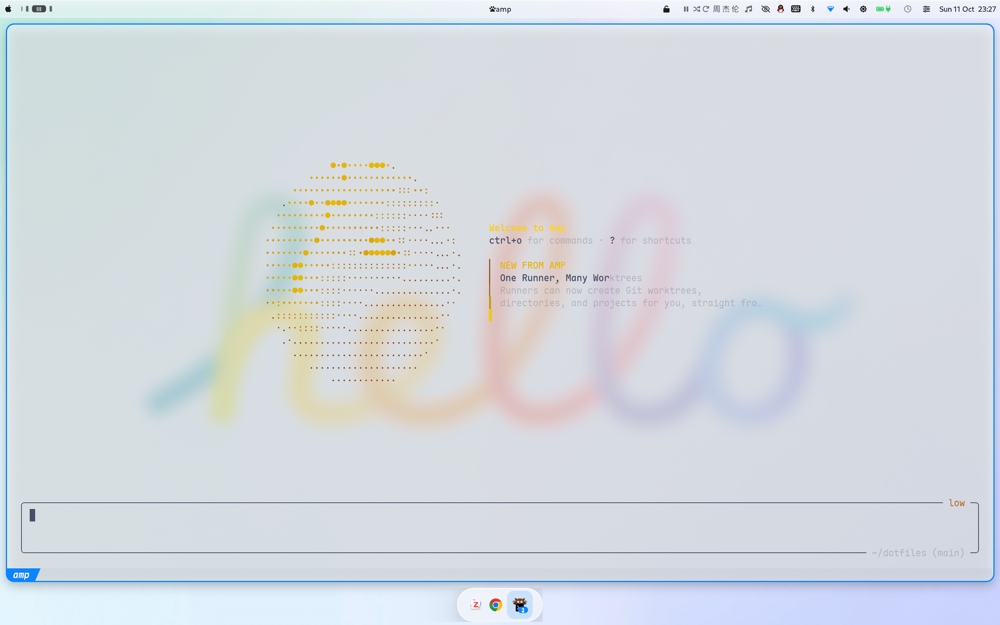

# dotfiles

my personal dotfiles

<div align="center">
	
</div>

## About

Arch Linux dotfiles for a Wayland desktop built around **niri**. Everything under
`dotfiles/` is one directory (or plain file) per app, and [`install.sh`](install.sh)
symlinks each of them into `$HOME`: directories to `~/.config/<name>`, plain files to
`~/.<name>`, skipping whatever is listed in its `excludeConfigs` array. `zsh`, `claude`
and `agents` follow their own rules, since those targets are not plain `~/.config` dirs.

- **Desktop**: niri, waybar (with a few locally compiled C++ modules), mako, tofi, swaybg, swayidle, swaylock
- **Terminal and shell**: kitty, alacritty, zsh (powerlevel10k + zoxide), bash
- **Everyday tools**: helix, yazi, mpd + ncmpcpp, cava, git, plus agent skills linked to `~/.agents`
- **Legacy**: hyprland and X11 configs, kept alongside the niri setup

```bash
git clone https://github.com/peakyet/dotfiles.git ~/dotfiles
cd ~/dotfiles && ./install.sh        # `./install.sh force` overwrites existing files and links
```

Package list and wish list: [Softwares.md](Softwares.md). Rebuilding the whole machine from
a blank Arch install: [INSTALL.md](INSTALL.md).

